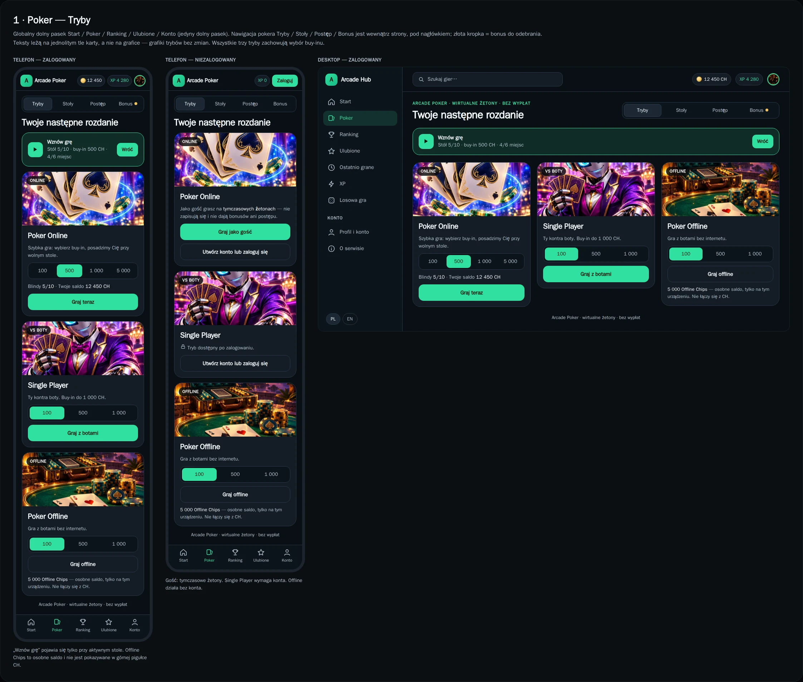
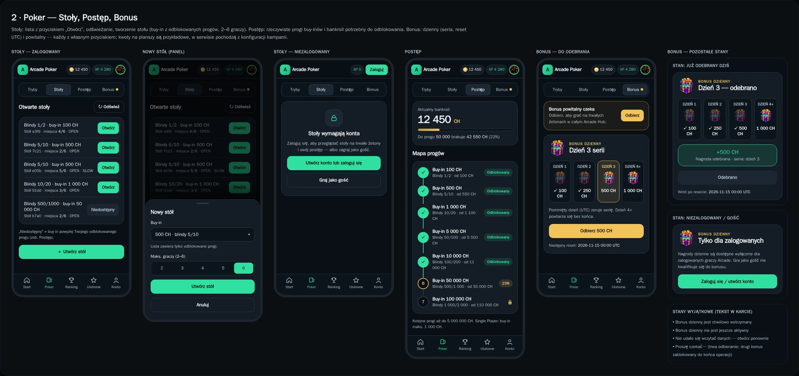
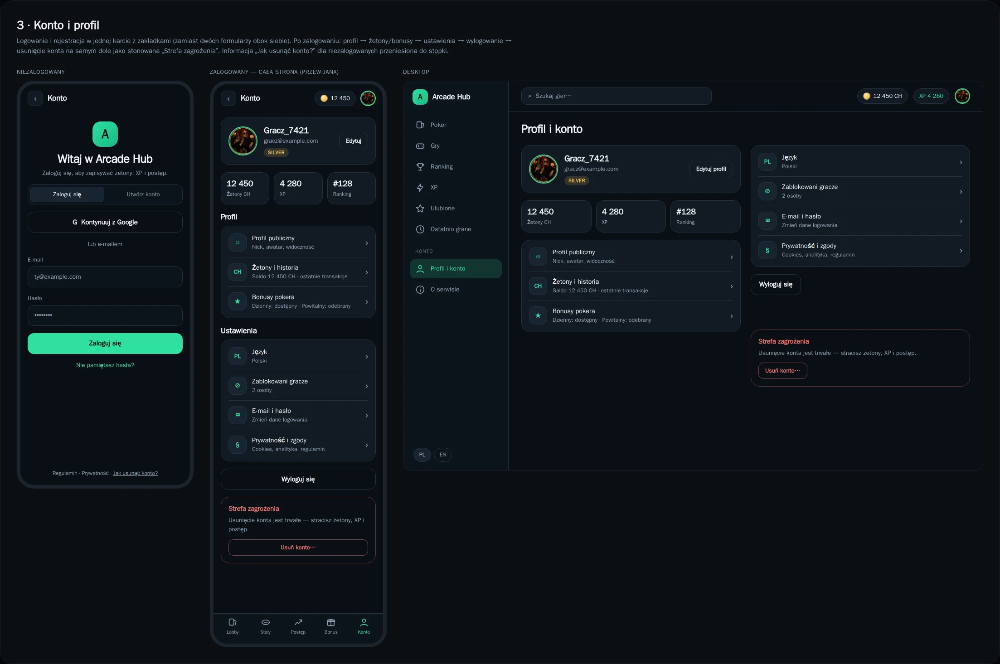
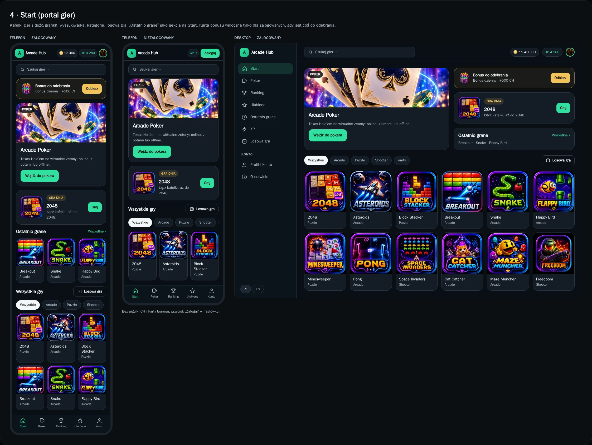
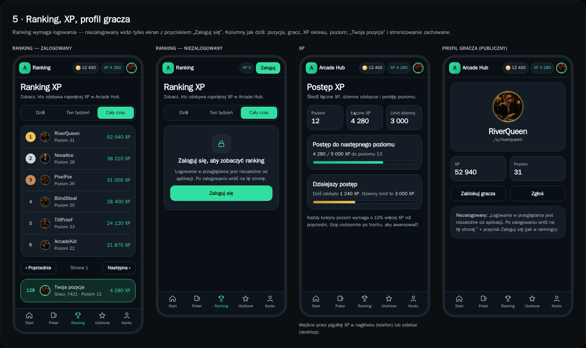
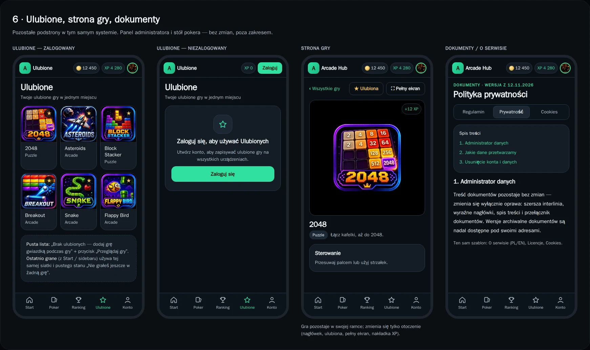

# UI redesign mockups — WWW, revision 2 (for OWNER acceptance)

Static mockups only; no product code is changed. Approved direction: variant A, Emerald Night. The poker table view and the admin page are out of scope. Chip amounts, player names and Polish copy are illustrative; bonus amounts come from campaign configuration.

Navigation:

- Mobile WWW: one global bottom bar — Start / Poker / Ranking / Ulubione / Konto.
- Poker: in-page contextual navigation — Tryby / Stoły / Postęp / Bonus.
- Desktop: one fixed sidebar across Arcade Hub.

## 1. Poker — modes

## 2. Poker — tables, progression, bonus

## 3. Account

## 4. Start (games portal)

## 5. Leaderboard, XP, player profile

## 6. Favorites, game page, documents

