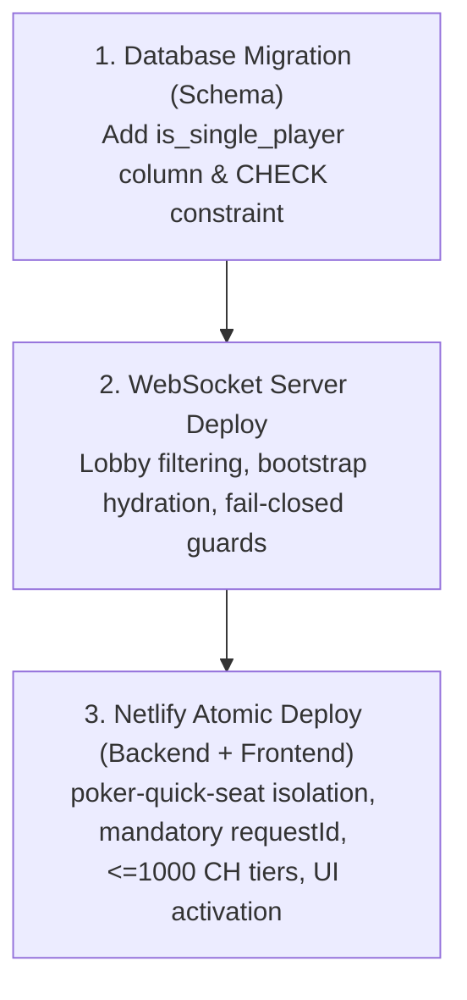

# Feature Specification: Poker Single Player vs Bots (#1077)

**Issue:** https://github.com/krzysztofcal/arcadePlatform/issues/1077  
**Baseline:** `main` (commit `e7fd0ce2`)  
**Status:** Owner decision approved Variant B (2026-10-11). Minimal forward-only migration for `is_single_player` authorized locally.

---

## 1. Owner Decision — Variant B Approved (Binding Contract)

The owner approved **Variant B with corrections**:
- Add `is_single_player boolean NOT NULL DEFAULT false` to `public.poker_tables`.
- One simple database `CHECK` constraint: when `is_single_player` is true, `lifecycle_kind = 'STANDARD'` **and** `created_by IS NOT NULL`.
- Do not modify `lifecycle_kind` values. Do not overload `managed_profile_key`, `stakes`, or `poker_state.state`.
- Do not add an index by default without measurement justification. The owner review measurement on 250,000 requests/10,000 tables justifies one partial QUICK_SEAT `(user_id, request_id)` lookup index; it does not change uniqueness.
- **Local Implementation Only:** The migration file and application changes are prepared locally. **Do not push any PR containing `supabase/migrations/**` until explicit owner authorization for the Stage migration side effect.**

---

## 2. Core Product Requirements

### SP-001 — Identity and Isolation
- **Online Cash Runtime:** Reuses the existing authoritative WebSocket runtime (`ws-server/`), table lifecycle, bot autoplay, reconnect, and CH ledger/escrow. It is **not** an offline client simulation or separate game engine.
- **Dedicated Tables:** Every new Single Player session creates a **brand-new dedicated table** belonging exclusively to that player and existing bots.
  - No matchmaking between human players.
  - Resume allows reconnecting to player's own active table(s) without second buy-in. When the user has multiple active tables, the lobby provides explicit selection.
  - A retained closed table rejects its original `requestId` with `table_closed`; after physical purge an expired ID returns `single_player_request_expired`. Neither path creates a second table.
  - Normal Poker Online never matches or lists Single Player tables.
  - Early `readPokerAccessSnapshot` takes row lock (`lock: true`) preventing race conditions with RESTRICTED overrides.
  - No joining or reusing tables of other humans.
  - Default Poker Online matchmaking / Quick Seat must never select or recommend Single Player tables.
- **Sole-Owner Resume:** A player may Resume/reconnect to their own existing active Single Player table without paying an additional buy-in.
  - Reconnect/Resume is restricted to the table creator (`created_by === userId`).
  - Cross-user table reuse is strictly forbidden.
  - Poker Online resume never silently routes to Single Player, and vice versa.

### SP-002 — Mode Discriminator
- The mode discriminator is the server-trusted, immutable column `poker_tables.is_single_player`.
- Enforced at table creation via `createPokerTableWithState({ isSinglePlayer: true })`.
- Cannot be altered or requested post-creation.

### SP-003 — Authoritative Fail-Fast Admission
- Inside `shared/poker-domain/join.mjs::executePokerJoinAuthoritative()` under `poker_tables ... FOR UPDATE`:
  - **Sole-Owner Check:** Only `created_by` may join or rejoin a Single Player table.
  - **Zero Other Humans:** Verify `activeSeatRows(seatRows)` and `state.seats` contain no other human. If another human is present or attempting admission, reject immediately (`single_player_human_conflict`).
  - **Hard 1000 CH Cap Check:** Verify `authoritativeBuyIn <= 1000`. Over-cap tables or requests are rejected immediately (`invalid_buy_in`).
  - **RESTRICTED Account Fail-Fast:** Reject `RESTRICTED` users immediately before any seat assignment, user chip debit, or bot funding resolution (`single_player_restricted_unavailable`).
  - **Fail-Fast Safety:** All rejections occur **before** seat assignment, buy-in debit, bot seeding, or state mutation.
  - No conversion, eviction, silent table switch, or second debit.
  - Contaminated/polluted table reconnect fails fast.
- Inside `ws-server/poker/handlers/join.mjs` and `ws-server/poker/table/table-manager.mjs`:
  - If `authoritativeJoinEnabled` is false or `observeOnlyJoinEnabled` is true, joining a Single Player table is **strictly fail-closed** (`single_player_authoritative_required`), preventing any non-authoritative fallback from seating an unauthorized player or second human.
  - `tableManager.join()` enforces that only an authoritative join with `authoritativeSeatNo` or an existing authoritative member can attach, and rejects any second human.

### SP-004 — Economy, Hard 1000 CH Cap, and Atomic Bot Funding
- **Hard 1000 CH Buy-In Cap:** Single Player tables accept **only currently enabled/unlocked tiers <= 1000 CH** (100, 500, 1000 CH if available).
  - Select all eligible Single Player tiers before applying any Poker Online highest-two window. A large bankroll must not hide 100/500/1000 CH; `singlePlayerAvailableBuyIns` is a separate progression response field. Poker Online retains its existing window.
  - Enforced in `poker-quick-seat.mjs` creation and authoritatively in `executePokerJoinAuthoritative()`.
  - Normal Poker Online multiplayer tables retain all higher tiers without change.
- **Immediate RESTRICTED Fail-Fast:**
  - `RESTRICTED` accounts are rejected at the entrance of `poker-quick-seat.mjs` (403 `single_player_restricted_unavailable`) and authoritatively in `join.mjs` before touching user bankroll or attempting bot pool funding.
- **Mandatory Bot Funding with Atomic Rollback:**
  - Single Player tables require the legitimate configured minimum bots (at least 2 bots, clamped by table capacity).
  - If bot funding from NORMAL/SLOW pool cannot provision the required bots, the JOIN **fails closed and rolls back the entire transaction** (`single_player_bot_funding_unavailable`).
  - Zero chips debited from the human player. Zero partial bot debits.
  - The table remains unjoined and will be pruned by standard inactive table cleanup.

### SP-005 — Dedicated Creation, Discovery, and UI
- Request routes through existing `netlify/functions/poker-quick-seat.mjs::handler()` with `mode: "single_player"`.
- Single Player new-play skips `selectCandidate()` and calls `createPokerTableWithState()`.
- **Request ID Intent Idempotency:**
  - Double-clicks, network retries, and timeouts with the **same `requestId`** reuse the existing table record from `poker_requests` without creating duplicates or hitting table limits (`strategy: "idempotent_replay"`).
  - Conscious "New Game" actions generate a new `requestId`, ensuring a brand-new dedicated table is created rather than reusing an old pending table.
- **Deterministic Resume:**
  - `selectExistingActiveSeat()` orders active seats deterministically by `coalesce(s.last_seen_at, s.created_at) desc`, and supports explicit `tableId` scoping when provided.
  - Use table ID as the final ordering tie-breaker; preserve the user's dropdown selection across progression updates.
- Normal table list and WS lobby exclude Single Player tables (`buildLobbyTableEntry` returns `null`).
- In `poker/index.html` and `poker/poker.js`:
  - Activate the Single Player card.
  - Expose only eligible unlocked tiers <= 1000 CH.
  - Show honest error states (e.g. bot pool unavailable or account RESTRICTED).
  - Preserve guest guidance, 44px touch targets, portrait/landscape responsiveness, and Daily Bonus (#1084).

### SP-006 — Runtime, Retention, and Cleanup
- Tables containing the human player receive `has_human_participant = true` upon successful join.
- Never treated as 7-day bot-only tables (#891). Standard human-table close/settlement/escrow retention policies (#923) apply.
- Normal table janitor and inactive session cleanup remain in effect.

### 2026-10-12 owner-approved bounded retry contract

- Single Player start intents use the existing `sp_<base36 timestamp milliseconds>_<random alphanumeric suffix>` format after `normalizeRequestId()`; whitespace normalization remains valid. Resume does not need a start request ID. Poker Online request IDs are unchanged.
- Valid start/retry IDs expire after 24 hours; at most 5 minutes future clock skew is accepted. Malformed or farther-future IDs return `400 invalid_request_id`; expired OPEN/missing/purged intents return `409 single_player_request_expired` without creation. At the exact 24-hour boundary the ID remains valid. A retained CLOSED intent keeps `409 table_closed`, even after expiry. A new user action may generate a new ID; retry keeps both ID and original buy-in across eligibility refresh.
- Existing closed-table cleanup protects trusted Single Player QUICK_SEAT rows for at least 24 hours plus 5 minutes from DB creation, in discovery, guarded DELETE and status eligibility, regardless of shorter table retention configuration. This covers a timestamp accepted 5 minutes ahead of server time; no permanent history, new table/tombstone or separate cleanup is required. Ordinary Online requests keep their existing retention rules.
- Early Single Player account access uses `lock: true`; administrative overrides take the existing per-user slot lock before account/table row locks, serializing against owner JOIN/rejoin.
- The immutable flag migration is classified as `shared-safe` with its exact SHA-256 in the Production inventory: 111 source files, 54 baseline/57 missing, categories 20/4/33 and seven unchanged replacements. The separate measured lookup migration is also shared-safe; neither classification authorizes database application or Production action.

---

## 3. Safe Phased Rollout & Protocol Compatibility

Because earlier versions of Poker Online do not filter by `is_single_player` and lack fail-fast Single Player guards, the rollout order must be strictly sequenced to prevent multi-human cross-play or lobby pollution:

1. **Step 1 — Database Migrations (Schema and Measured Lookup):**
   - Applies forward-only `is_single_player boolean NOT NULL DEFAULT false` with `poker_tables_single_player_chk`.
   - Applies separate forward-only `20261012095657_poker_single_player_request_lookup.sql` after the flag migration, preserving the existing unique request constraint.
   - Backward-compatible; existing tables and running WS/functions remain unaffected (`is_single_player = false`).
2. **Step 2 — WebSocket Server Deploy:**
   - Deploys updated WS server with bootstrap hydration of `is_single_player`, lobby exclusion (`buildLobbyTableEntry` returning `null`), and fail-closed non-authoritative join protection (`single_player_authoritative_required`).
   - Pinned SHA provides unambiguous rollback point.
   - **Crucial:** No Single Player tables can be created prior to Step 2, ensuring that any Single Player tables subsequently created will never leak into public lobbies or allow non-authoritative joins.
3. **Step 3 — Netlify Atomic Deploy (Backend + Frontend):**
   - Deploys Netlify functions (`poker-quick-seat.mjs`, `poker-progression.mjs`) together with web assets (`poker/index.html`, `poker/poker.js`, `poker/poker.css`) in a single atomic release.
   - Netlify functions enforce mandatory `requestId` on New Game, early `RESTRICTED` 403 rejection, 1000 CH cap, candidate isolation (`coalesce(is_single_player, false) = false`), and separate explicit `tableId` Resume.
   - Frontend UI exposes the Single Player card, interactive tier selector (`<= 1000 CH`), and client-side double-click/retry protection.
   - Older clients connecting to Poker Online cannot see or join Single Player tables. Newer clients creating Single Player tables are immediately protected by the already-active WS server.
