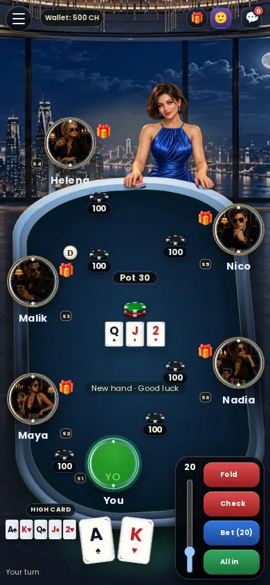
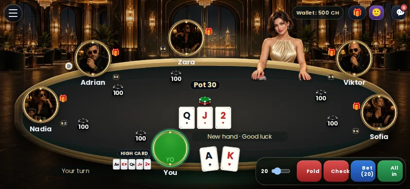

# #800 validation and handoff

Draft PR: https://github.com/krzysztofcal/arcadePlatform/pull/1082
Deploy Preview: https://deploy-preview-1082--playkcswh.netlify.app/poker/table-v2.html
Runtime revision: ae3899aff708481165f52cdc60e662a6648bdf9e. Later changes to this report/tasks/screenshots are documentation only.

## Evidence
- Baseline Poker V2 suite: 144 tests passed before changes.
- Fundamental theme tests failed before implementation (no automatic theme/preload). Whitespace-ID agreement failed before transport-compatible normalization.
- Final focused live/client, join, rebuy and authoritative-join regressions: 198 passed, zero failures.
- JavaScript syntax, diff whitespace, lifecycle, XP transport and CSP inline hashes passed; CSP guard covers 55 served documents. Existing lifecycle waivers remain unchanged. No HTML/inline script added.
- Independent review found no blockers; resolved the noted whitespace-ID edge case with a regression test.
- CSS comparison proves only theme attribute renaming and removal of obsolete chooser focus rule; no geometry changes.
- All applicable CI checks passed for runtime revision ae3899aff708481165f52cdc60e662a6648bdf9e, including core, Playwright, CodeQL, WS harness/persistence and Netlify Preview. Exact-head checks on the Draft PR record subsequent documentation verification. WS package validation is not a WS deployment; this presentation-only change needs no WS deployment.

## Browser Preview smoke
Chromium inspected actual deployed HTML/CSS/renderer/assets at 390x844 and 844x390 for six deterministic fixture IDs: table-0 Crimson, table-1 Midnight, table-2 Classic, table-3 Emerald, table-4 Neon, table-5 Royal. Existing selectors load the correct room/rail/felt/dealer/cards/avatar art. Theme chooser is absent. Reload and reconnect retain Midnight without a new theme resource request; no rebuy command occurs. Blocking Midnight card-back.svg restores Classic. No page JavaScript errors in the smoke.

Identity, WS state and CH responses were isolated browser fixtures; no real tables, seats, ledger mutations or Production calls were used. This confirms rendering and client recovery, not an authenticated runtime or ledger smoke. Representative screenshots accompany this report.

## Impact and limits
Every table, including existing ones, now follows the owner-approved hash mapping. Existing open old tabs need the accepted one-time manual refresh. Fixed catalog order/hash must stay stable. Classic fallback may differ locally when an asset cannot load. Renderer remains a JSP-compatible IIFE and does not change CH, snapshot/reconnect/gameplay authority, backend, WS protocol, settings or payments. No merge or Production changes.

Implementation ready, awaiting manual runtime verification; Draft PR is not called merge-ready.

## Phone smoke on Preview
1. Open the Poker lobby on this Preview, sign in and use a real Preview table. Refresh each already-open Preview tab once; keep the same table URL/seat.
2. Compare two clients/tabs at the same table: theme agrees. Open other tables: assignment may differ. Inspect portrait and landscape, cards and controls.
3. At an idle table, note wallet and seat stack and confirm no join/rebuy/action is pending. Refresh and briefly interrupt the network, then restore it. Same seat/theme returns; no additional buy-in/rebuy CH transaction occurs. A hand/bet or retired seat must be assessed separately.
4. Inspect a later hand and a late joiner: theme stays fixed. Optionally block one theme artwork request in desktop DevTools and reload: full scene falls back to Classic.

